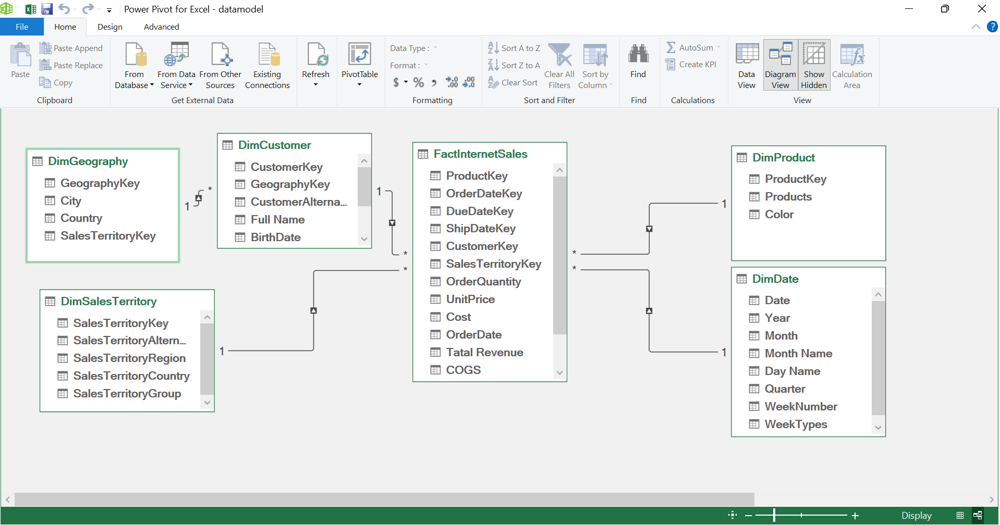
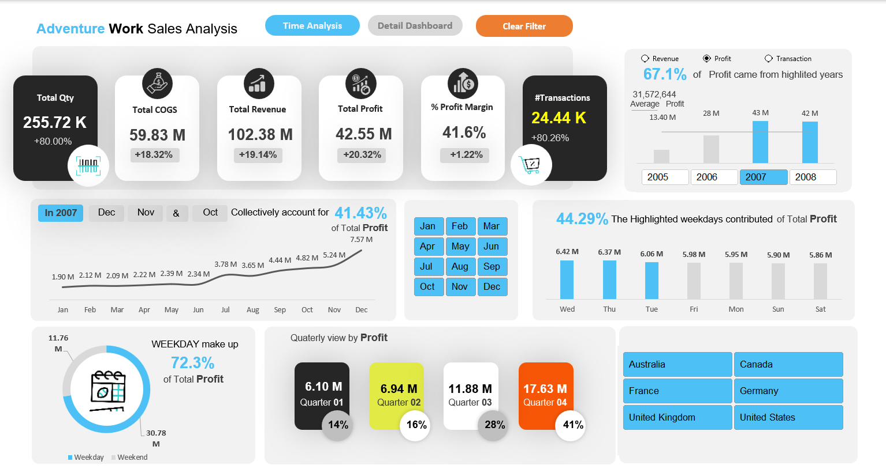
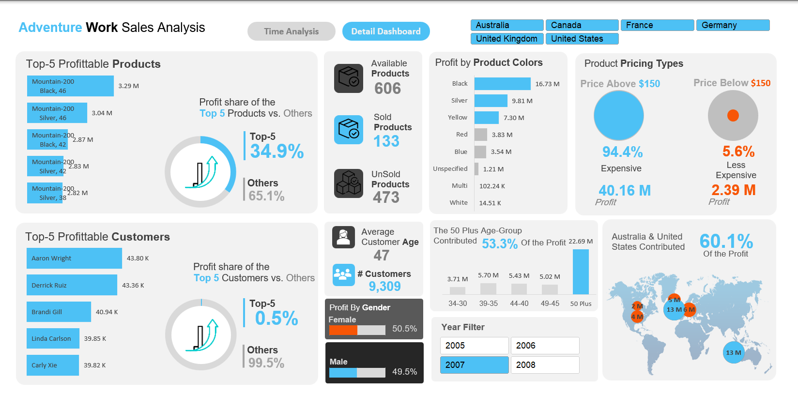

# AdventureWorks Sales Analysis | Excel Dashboard

> **Executive summary:** Analyzed AdventureWorks sales data (**$102.4M revenue, $42.6M profit, 41.6% margin, 24.4K transactions**) and built a 2-page interactive Excel dashboard. Key findings: profit is highly seasonal (Q4 = 41%), almost entirely driven by premium products (94.4%), concentrated in one product line (Mountain-200), while **78% of the catalog never sold**.

<!-- TODO: state which year/period the KPI numbers above represent (e.g. "FY2007") -->

---

## 1. Business Problem

AdventureWorks is a bicycle and accessories company selling internationally. Management needs to understand:

- When, where, and from whom does profit come?
- Which products, colors, and price segments drive profit?
- Is the business dependent on a few products or customers?
- Which parts of the catalog are not performing?

## 2. Dataset & Data Model

- **Source:** AdventureWorks sample dataset (`AdventureWorks (Dataset).xlsx`)
- **Structure:** Sales data linked to Product, Customer, Territory, and Date tables
<!-- TODO: describe how you prepared it: Excel Tables / Power Query / Data Model (Power Pivot) / lookup formulas -->

<!-- TODO: add a screenshot of the model view -->
<!--  -->

<p align="center">
  <a href="data_model.png">
    
  </a>
</p>

## 3. Tools & Skills

Microsoft Excel · PivotTables ·  Data Modeling . Dax . Power Query ( Transfomations , Data cleaning ) Slicers · Interactive Charts · Dashboard Design · Business Storytelling
<!-- TODO: add only what you really used: Power Query, Power Pivot/Data Model, XLOOKUP/INDEX-MATCH, SUMIFS, etc. -->

## 4. Dashboard

### Page 1: Time Analysis
KPIs (Qty, COGS, Revenue, Profit, Margin, Transactions), profit by year, month, weekday, quarter, and country filters[cite: 2].

### Page 2: Detail Dashboard
Top-5 products and customers, product colors, pricing types, catalog coverage, customer age groups, gender split, and geography[cite: 3].

<table>
  <tr>
    <td align="center" width="50%">
      <a href="time_analysis.png">
        
      </a>
      <sub>Time Analysis</sub>
    </td>
    <td align="center" width="50%">
      <a href="detail_dashboard.png">
        
      </a>
      <sub>Detail Dashboard</sub>
    </td>
  </tr>
</table>

## 5. Key Calculations

```
Revenue       = Quantity x Unit Price
Profit        = Revenue - COGS
Profit Margin = Profit / Revenue
```
<!-- TODO: replace with your real formulas / calculated fields (e.g. SUMIFS, calculated fields in PivotTables, Top-5 share, unsold products count) -->

## 6. What I Found (Insights)

### Profit is very seasonal
Most of the profit comes at the end of the year. Q4 brought in $17.63M (41% of the profit) while Q1 only made $6.10M, so Q4 is about three times bigger. October, November and December alone make up 41.4% of the year's profit.
**My recommendation:** prepare stock and campaigns during Q3 so the company is ready before the peak, and use Q1 for offers and clearance.

### Premium products carry the business
Products priced above $150 generated $40.2M, which is 94.4% of the profit. Cheaper products only added 5.6%.
**My recommendation:** put most of the marketing effort on the premium products, and treat the cheap ones as add-ons.

### One product line is a big risk
The top 5 products are all Mountain-200 (different colors and sizes) and together they make 34.9% of the profit. If anything goes wrong with this line, whether supply or competition, the profit would drop quickly.
**My recommendation:** secure the supply for Mountain-200 and push other strong lines so the profit is more spread out.

### Most of the catalog never sold
The company has 606 products, but only 133 were sold. That means 473 products (78%) had no sales at all, and they still cost money to store and manage.
**My recommendation:** review these products, then discontinue or bundle the slow ones.

### The business does not depend on a few customers
The top 5 customers contributed only 0.5% of the profit, out of 9,309 customers. So losing one big customer would not hurt much.
**My recommendation:** focus on getting and keeping many customers instead of building a VIP strategy.

### Where the profit comes from
Australia and the United States together make 60.1% of the profit. Customers aged 50+ contribute 53.3% of it, and the average customer age is 47. Black is the best color ($16.7M, around 39% of profit), followed by Silver ($9.8M) and Yellow ($7.3M).
**My recommendation:** focus on these two markets, target the 50+ group in campaigns, and stock more of the best-selling colors.

### Things that did not show a clear pattern
Weekdays make up 72.3% of the profit, but that is about what you would expect from 5 days out of 7, and the individual days are very close to each other. Gender is also balanced (50.5% female and 49.5% male). I did not build any recommendation on these two.

## 7. Limitations & Assumptions

- Findings reflect the selected period/filters shown in the screenshots. <!-- TODO: specify the year -->
- The "50+" age group is open-ended, so it is not directly comparable to the 5-year bands.
 <!-- TODO: note whether 2008 data is complete or partial, since 2008 ($42M) is slightly below 2007 ($43M) -->
- This is a practice/portfolio project using a public sample dataset, so recommendations are illustrative.
